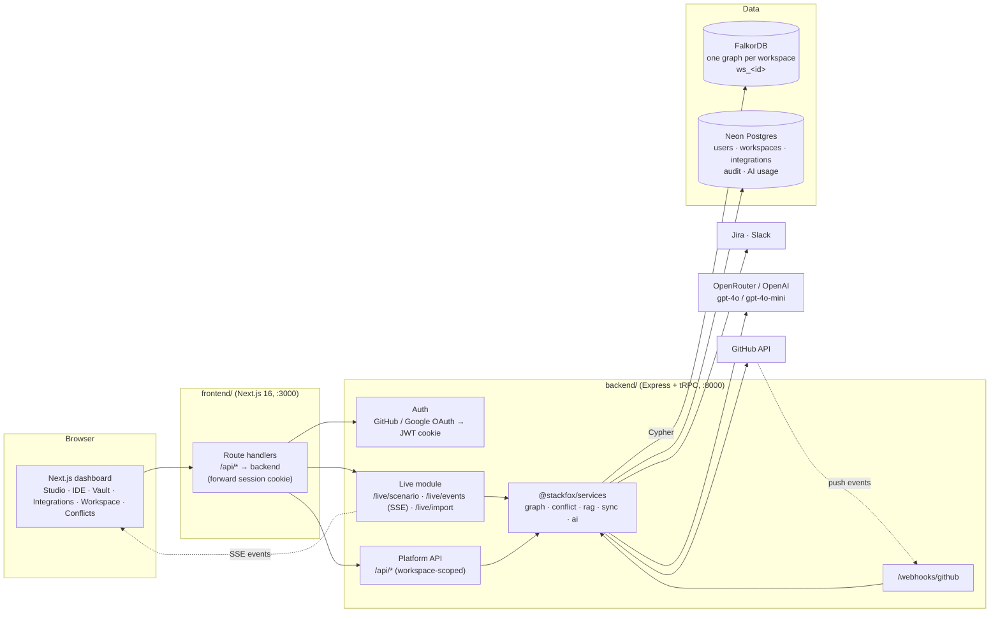
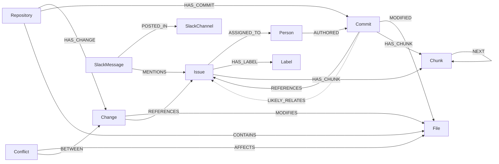
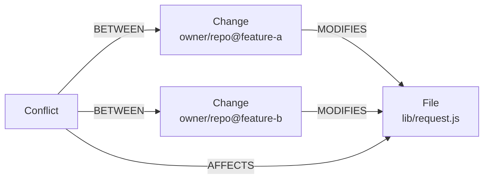
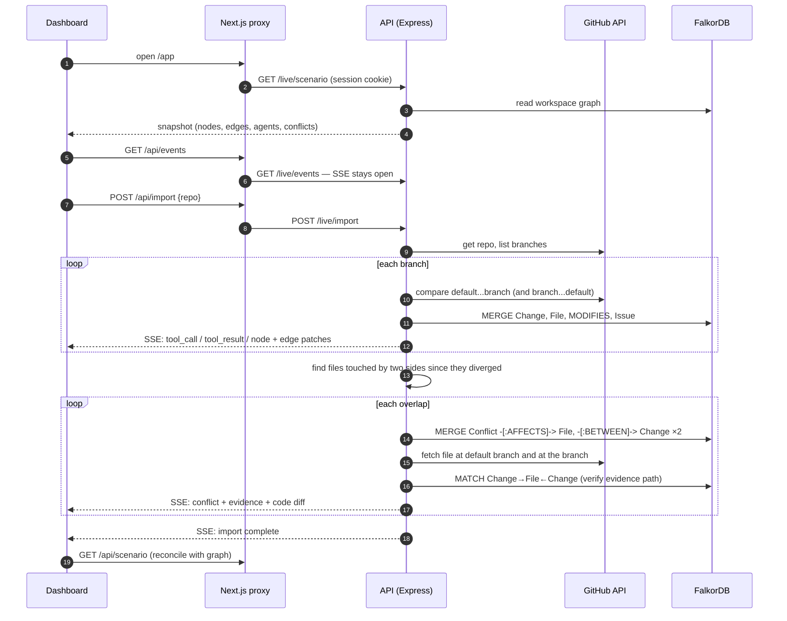

# Stackfox

**A FalkorDB knowledge graph of your team's code changes, so parallel branches — human or AI-agent — find out they collide before they merge.**

Stackfox imports a GitHub repository's branches, writes every pending change, file, issue and conflict into a per-workspace **FalkorDB** graph, and streams the result live into a graph studio. Conflict detection, the evidence shown for each conflict, the dashboard itself and the AI review context all come from Cypher queries against that graph.

> Built for **WeMakeDevs Graph Hacks: Context for AI Agents** (FalkorDB).

| | |
|---|---|
| **Live demo** | [graph-hack-1.onrender.com](https://graph-hack-1.onrender.com/) · API: [graph-hack-t03w.onrender.com/health](https://graph-hack-t03w.onrender.com/health) _(free tier, may take ~50 s to wake)_ |
| **Demo video** | _add video link_ |
| **Stack** | FalkorDB · Next.js 16 · Express + tRPC · Neon Postgres · OpenRouter / OpenAI · Render |

---

## Contents

1. [What it does](#what-it-does)
2. [Architecture](#architecture)
3. [The graph](#the-graph)
4. [How the agent uses the graph](#how-the-agent-uses-the-graph)
5. [End-to-end flow](#end-to-end-flow)
6. [Dashboard](#dashboard)
7. [Run it locally](#run-it-locally)
8. [Configuration](#configuration)
9. [Deploying](#deploying)
10. [Project layout](#project-layout)
11. [Security](#security)
12. [Limitations](#limitations)

---

## What it does

When several people or coding agents work on separate branches, Git only notices a problem at merge time — and only if the same lines changed. Stackfox keeps a shared graph of *who is changing what* so the overlap is visible while the work is still in progress.

- **Import a repository** (`owner/repo`). Stackfox compares every branch with the default branch through the GitHub API and writes the result into FalkorDB.
- **Detect conflicts in the graph.** Two pending changes that `MODIFIES` the same `File` since they diverged become a `Conflict` node, and the shortest path that explains it is verified with Cypher before it is shown.
- **Watch it live.** Every GitHub call, graph write and conflict streams to the dashboard over Server-Sent Events, with the Cypher behind each step.
- **Review with AI.** For a conflict, Stackfox gathers graph context (linked issues, decisions, discussions) and asks the model for review steps — advice only; nothing is merged automatically.
- **Work with the team.** GitHub/Jira/Slack integrations feed the same graph; a shared API vault, a web IDE on a per-user branch, and workspace roles round it out.

---

## Architecture



| Component | Responsibility |
|---|---|
| `frontend/` | Next.js App Router UI. Its `/api/*` route handlers proxy to the backend with the browser's session cookie, so the browser only ever talks to one origin. |
| `backend/apps/web` | The workspace app: Google sign-in, invitations, members and roles, integrations, shared services, the IDE and the conflicts page. It proxies `/api-backend/*` to the API, so cookies stay same-origin. `frontend/` is the graph studio and landing page; both talk to the same API and graph. |
| `backend/apps/api` | Express server: OAuth callbacks, the live SSE stream, the workspace-scoped REST API, GitHub webhooks and the tRPC endpoint. Every data route resolves the signed-in user's workspace first. |
| `backend/packages/services` | All business logic: FalkorDB access, the GitHub importer, conflict detection, GraphRAG, Jira/Slack sync, the AI router and the Postgres data layer. |
| **FalkorDB** | The source of truth for the code graph. Each workspace gets its own graph (`ws_<workspaceId>`), so tenants are isolated at the database level. |
| **Neon Postgres** | Users, workspaces, members, encrypted integration secrets, sync runs, audit log, AI usage — everything that is not graph data. |

---

## The graph

### Nodes

| Label | Key properties | Written by |
|---|---|---|
| `Repository` | `name`, `defaultBranch`, `importedAt` | importer, push webhook |
| `Change` | `id` (`owner/repo@branch`), `branch`, `title`, `authors`, `ahead`, `behind`, `headSha`, `isDefault` | importer — one per branch: everything it has that the default branch does not |
| `Commit` | `sha`, `message`, `author`, `branch`, `at` | push webhook |
| `File` | `path`, `language`, `repo`, `baseContent` | importer, push webhook |
| `Conflict` | `id`, `file`, `a`, `b` (the two `Change` ids), `status`, `detectedAt` | importer |
| `Issue` | `key`, `title`, `status`, `priority`, `url` | Jira sync; also created from issue keys found in commit messages |
| `Person` | `name` | push webhook, Jira sync |
| `SlackChannel` / `SlackMessage` | `name` / `text`, `user`, `ts`, `url` | Slack sync |
| `Label` | `name` | Jira sync |
| `Chunk` | `text`, `index` | GraphRAG chunking of commits and issues (no vector store) |
| `Function`, `Decision`, `Discussion` | `name`, `file` / `title`, `rationale` / `text`, `channel` | Read by retrieval and the conflict reviewer. Nothing in the importer or syncs writes them yet, so they appear only if you add them (see [Limitations](#limitations)). |

### Relationships



A conflict in the graph is a concrete, checkable shape — two changes meeting at one file:



---

## How the agent uses the graph

Every decision below is the result of a Cypher query against the workspace's FalkorDB graph. The queries are copied from the code.

### 1. Detecting conflicts

**Imported branches** — for every pair of branches (and each branch against the default branch's progress since it diverged), the importer finds files both sides modified, writes a `Conflict`, and then **proves the path exists in the graph** before reporting it:

```cypher
MATCH (a:Change {id: $a})-[:MODIFIES]->(f:File {path: $file})<-[:MODIFIES]-(b:Change {id: $b})
RETURN count(f) AS n
```

The evidence path shown in the inspector is that same pattern, `Change → File ← Change`.

**Pushed commits** (from GitHub webhooks) — conflict candidates are found entirely in Cypher:

```cypher
MATCH (f:File)<-[:MODIFIED]-(a:Commit), (f)<-[:MODIFIED]-(b:Commit)
WHERE a.branch <> b.branch AND a.sha < b.sha
RETURN f.path AS file, a.sha AS shaA, a.author AS authorA, a.message AS messageA, a.branch AS branchA,
       b.sha AS shaB, b.author AS authorB, b.message AS messageB, b.branch AS branchB
```

With GitHub connected, each candidate is then checked against the real diffs and kept only if the edited line ranges overlap.

### 2. Building the live dashboard

The Studio is a projection of the graph — nodes, edges, agents (branches), changes, conflicts and file diffs are read back with queries such as:

```cypher
MATCH (n) RETURN id(n) AS id, labels(n)[0] AS label, properties(n) AS props LIMIT $limit
MATCH (a)-[r]->(b) RETURN id(a) AS s, id(b) AS t, type(r) AS type LIMIT $limit
MATCH (c:Change)-[m:MODIFIES]->(f:File) WHERE m.content IS NOT NULL
RETURN c.id, c.branch, f.path, f.baseContent AS original, m.content AS modified
```

Node size is degree centrality computed from those edges, so the files that many branches touch stand out.

### 3. GraphRAG (vectorless)

Questions are answered from the graph, not from a vector store (`services/src/graph/rag.ts`, exposed as the tRPC procedure `graph.ask`):

1. **Index** — on first use each workspace graph gets range indexes on the lookup keys (`Function.name`, `File.path`, `Commit.sha`, `Issue.key`, …) and full-text indexes on commit messages, issue titles, discussions, decisions and chunks. Creation is idempotent.
2. **Seed** — extract keywords, then merge two kinds of match across `File`, `Commit`, `Issue`, `Conflict`, `SlackMessage`, `Person` and more: property matches ranked in Cypher, and full-text hits from FalkorDB's index. Scores are combined and the top 8 become seeds:
   ```cypher
   MATCH (n:File) WHERE toLower(toString(n.path)) CONTAINS $k0_0
   RETURN id(n) AS id, labels(n)[0] AS label, properties(n) AS props, (...) AS retrievalScore
   ORDER BY retrievalScore DESC LIMIT 25

   CALL db.idx.fulltext.queryNodes('Issue', $q) YIELD node, score
   RETURN id(node) AS id, labels(node)[0] AS label, properties(node) AS props, score
   ORDER BY score DESC LIMIT 5
   ```
3. **Expand** — walk one hop out and in from each seed, prioritising `CALLS`, `TESTS`, `REFERENCES`, `MODIFIED`:
   ```cypher
   MATCH (n)-[r]->(nb) WHERE id(n) = $id
   RETURN type(r) AS relType, labels(nb)[0] AS nbLabel, properties(nb) AS nbProps LIMIT 20
   ```
4. **Go further** — for the three strongest seeds, follow 2–3 hop paths to issues, decisions, discussions, people, tests and commits (for example `Issue ← Commit → File ← Commit`), then ask for the shortest bounded path between the top two results:
   ```cypher
   MATCH p = (s)-[*2..3]-(t)
   WHERE id(s) = $id AND labels(t)[0] IN $labels AND id(t) <> id(s)
   RETURN [n IN nodes(p) | labels(n)[0]] AS labels, [r IN relationships(p) | type(r)] AS rels LIMIT 8
   ```
5. **Answer** — the evidence (capped at ~14k characters) is the only context the model gets, and the executed Cypher is returned with the answer.

The full-text, multi-hop and path queries run only on a live FalkorDB graph and each fails independently, so a missing index or procedure falls back to the basic retrieval instead of failing the request. We have run them against a small sample graph on FalkorDB Cloud; they have not been benchmarked on large repositories.

### 4. AI conflict review

Before calling the model, the reviewer collects what the graph knows about the conflicting work — e.g. issues each side references:

```cypher
MATCH (c:Commit {sha: $shaA})-[:REFERENCES]->(i:Issue)
RETURN i.key AS key, i.title AS title, i.status AS status
```

It also looks for `Decision` and `Discussion` nodes that constrain or concern the affected code, and adds two checks computed from the graph:

- **Ownership** — authors ranked by how many commits touched the file. If a conflicting change comes from someone who rarely works in that file, the review says so and recommends the usual owner look at it.
  ```cypher
  MATCH (c:Commit)-[:MODIFIED]->(f:File {path: $file})
  RETURN c.author AS author, count(c) AS commits ORDER BY commits DESC LIMIT 5
  ```
- **Impact radius** — callers in other files, up to two `CALLS` hops away, as a re-test list.
  ```cypher
  MATCH (f:Function) WHERE f.file = $file
  MATCH (c:Function)-[:CALLS*1..2]->(f) WHERE c.file <> $file
  RETURN DISTINCT c.name AS caller, c.file AS file LIMIT 15
  ```

The same data backs the `graph.fileInsight` procedure, used for the hover summary on a conflict's file name. The model is told to use only that evidence plus the diff excerpts, and the UI shows whether graph context was found — when nothing relevant is in the graph, it says so instead of inventing context.

### 4b. Commits that find their task

A push whose commit message has an explicit Jira key (`SF-12`) is linked to that issue, and moved to *In Progress* only if the Jira integration has that option enabled and the issue is not already there. For commits without a key, Stackfox suggests up to three likely issues from a full-text match on the message and from issues already linked to the files the commit changed. Suggestions are stored as `LIKELY_RELATES` edges and mentioned in the Slack summary. They never change a ticket.

### 5. Your own queries

The IDE has a read-only Cypher runner scoped to your workspace graph. Write clauses (`CREATE`, `MERGE`, `DELETE`, `SET`, …) are rejected server-side.

```cypher
MATCH (c:Change)-[:MODIFIES]->(f:File)<-[:MODIFIES]-(other:Change)
WHERE c <> other
RETURN f.path AS file, collect(DISTINCT c.branch) AS branches
ORDER BY size(branches) DESC LIMIT 10
```

Run against an import of `expressjs/express`, it surfaces the hotspot straight away:

| file | branches |
|---|---|
| `lib/request.js` | `4.x`, `bsebas/check-first-referer`, `defineProperties-vs-defineProperty`, `feat/fresh-query-method`, `master` |
| `package.json` | `4.x`, `feat/list-routes-subapps`, `master` |

---

## End-to-end flow

What happens when you import a repository in the Studio:



---

## Dashboard

| Tab | What it shows |
|---|---|
| **Studio** | Force-directed view of the workspace graph, branches as agents, a live event log of every GitHub call and graph query, and an inspector with the evidence path and real file diffs. |
| **Conflicts** | Every open conflict with both sides' branch, author and commit, diff evidence when available, and an AI review rendered from the model's answer. |
| **IDE** | The connected GitHub repo: browse branches and files, save shared drafts, commit to your own `stackfox/user-…` branch, open a pull request, and run read-only Cypher. |
| **Integrations** | Connect / test / sync / disconnect GitHub, Jira and Slack; synced issues and messages; sync runs; audit log. |
| **API Vault** | Share an HTTPS API with the workspace; its token stays encrypted on the server and is injected per call. |
| **Workspace** | Members and roles, invitations, AI token usage, and live FalkorDB / Postgres status. |

---

## Run it locally

**Prerequisites:** Node.js 20+, Docker Desktop, a Postgres database (a free [Neon](https://neon.tech) project works).

```bash
# 1. FalkorDB (graph on :6379, FalkorDB Browser on :3001)
cd backend
docker compose up -d falkordb

# 2. Backend
cp .env.example .env          # then fill in the values below
npm install
npm run db:migrate            # applies the SQL migrations to Postgres
npm run dev                   # API on http://localhost:8000

# 3. Frontend (new terminal)
cd frontend
npm install
npm run dev                   # http://localhost:3000
```

Open http://localhost:3000/signin, sign in with GitHub, then in **Studio** import a repository with a few active branches (for example `expressjs/express`).

To see the graph directly, open the FalkorDB Browser at http://localhost:3001 and select the graph named `ws_<workspace id>` (shown above the Studio canvas).

---

## Configuration

`backend/.env` (see `backend/.env.example`):

| Variable | Required | Purpose |
|---|---|---|
| `DATABASE_URL` | yes | Postgres connection string |
| `FALKORDB_HOST`, `FALKORDB_PORT`, `FALKORDB_PASSWORD` | yes | FalkorDB connection (`localhost`, `6379`, empty locally). In production the host must not be localhost and a password is required |
| `FALKORDB_USERNAME` | FalkorDB Cloud | ACL username (`falkordb` on the free tier); leave empty locally |
| `FALKORDB_GRAPH` | optional | Default graph name (`stackfox`); workspaces use their own `ws_<id>` graph |
| `JWT_SECRET` | yes | Signs session cookies. In production it must be at least 32 characters; the web and API services must share it |
| `JWT_REFRESH_SECRET` | recommended | Signs refresh tokens |
| `ENCRYPTION_KEY` | production | Encrypts stored integration and vault credentials (AES-256-GCM), at least 32 characters. Set it once and keep it, or saved credentials can no longer be decrypted. Outside production it falls back to `JWT_SECRET` |
| `NODE_ENV` | yes | `production` turns on strict env checks and disables the in-memory graph fallback |
| `DEV_LOGIN_ENABLED` | no | `true` allows passwordless dev sign-in; keep `false` in production |
| `CLIENT_URL` | yes | Frontend origin, e.g. `http://localhost:3000` (HTTPS in production) |
| `GITHUB_OAUTH_CLIENT_ID`, `GITHUB_OAUTH_CLIENT_SECRET` | for GitHub sign-in | OAuth App callback: `<API_PUBLIC_URL>/auth/github/callback` |
| `GOOGLE_OAUTH_CLIENT_ID`, `GOOGLE_OAUTH_CLIENT_SECRET`, `GOOGLE_OAUTH_REDIRECT_URI` | for Google sign-in | redirect: `<CLIENT_URL>/api-auth/google/callback` |
| `GITHUB_TOKEN` | recommended | Raises the GitHub API limit for imports from 60 to 5,000 requests/hour; needed for private repos |
| `OPENAI_API_KEY` or `OPENROUTER_API_KEY` | for AI features | Conflict review and GraphRAG answers. If both are set, OpenRouter is used. Production requires one of them |
| `API_PUBLIC_URL` | for webhooks | Public URL of the API (GitHub must reach `/webhooks/github`); HTTPS in production |
| `API_INTERNAL_URL` | web app | Origin of the API that the web app proxies to |
| `RESEND_API_KEY`, `EMAIL_FROM` | optional | Invitation and welcome emails. The default `onboarding@resend.dev` sender only delivers to the account owner, so use a verified domain to email teammates |
| `FP_SALT` | yes | Salt for device-fingerprint hashing used by AI rate limits. At least 32 characters and not the example value in production, or the API refuses to start |

`frontend` environment:

| Variable | Default | Purpose |
|---|---|---|
| `STACKFOX_BACKEND_URL` | `http://localhost:8000` | Where the Next.js route handlers forward `/api/*` and `/live/*` |
| `STACKFOX_DEMO_AUTH_ENABLED` | off | `true` enables passwordless email sign-in for local development only |

---

## Deploying

`render.yaml` at the repository root describes the API, the workspace web app and a private FalkorDB service for Render. We run FalkorDB on [FalkorDB Cloud](https://app.falkordb.cloud) (free tier), which is a drop-in replacement: set `FALKORDB_HOST`, `FALKORDB_PORT`, `FALKORDB_USERNAME` and `FALKORDB_PASSWORD`. TLS is not required for the free-tier endpoint.

| Service | Root directory | Build | Start |
|---|---|---|---|
| API | `backend` | `npm install` | `npm run start:api` |
| Workspace web app | `backend` | `npm install --include=dev && npm run build` | `npm run start:web` |
| Graph studio (optional) | `frontend` | `npm install --include=dev && npm run build` | `npm run start` |

Notes from deploying it:

- **Run migrations separately.** `npm run db:migrate` (from `backend/`) applies the SQL migrations and records a checksum for each. Run it once against the production database before the first deploy and after adding a migration. Checksums ignore line endings, so a migration applied from Windows still verifies on Linux.
- **Dev dependencies.** Render sets `NODE_ENV=production`, which skips `devDependencies`. The Next.js builds need them, hence `--include=dev`.
- **Shared secrets.** The API and web services must use the same `JWT_SECRET`.
- **Google OAuth.** Add `<web URL>` to the authorised JavaScript origins and `<web URL>/api-auth/google/callback` to the redirect URIs.
- **GitHub, Jira and Slack** credentials are entered per workspace under **Integrations** after sign-in; they are stored encrypted in Postgres, not in the environment.
- Free Render services sleep after inactivity, so open the URL once before a demo.

---

## Project layout

```
backend/
  apps/api/src/
    index.ts                  Express app: routes, tRPC, CORS, cookies
    routes/live.ts            /live/scenario, /live/events (SSE), /live/import
    routes/platform.ts        /api/* — workspace, vault, IDE, conflicts, integrations
    routes/github-auth.ts     GitHub OAuth sign-in
    routes/google-auth.ts     Google OAuth callback, dev login
    routes/github-webhook.ts  signed GitHub push events
  packages/services/src/
    graph/                    FalkorDB client, read-only Cypher, GraphRAG, chunking
    live/                     importer, snapshot builder, SSE event bus
    conflict/                 detection, GitHub diff scan, AI resolution
    sync/                     Jira and Slack → graph
    workspace/                members, integrations, vault, GitHub files, drafts
    ai/                       model router, rate limits
    db/                       Drizzle schema, SQL migrations
  packages/trpc/              tRPC routers (same services, typed API)
  docker-compose.yml          FalkorDB (+ optional VS Code server)
frontend/
  src/app/                    pages and /api route handlers (proxy to backend)
  src/components/dashboard/   Studio: graph canvas, agents rail, event log, inspector
  src/components/views/       IDE, Vault, Integrations, Workspace, Conflicts
  src/lib/                    API client, live store, shared types
```

---

## Security

- **Tenant isolation:** each workspace has its own FalkorDB graph; every API route resolves the signed-in user's workspace and checks membership/roles before touching data.
- **Read-only Cypher** for user queries; write clauses are rejected on the server.
- **Secrets** (GitHub/Jira/Slack credentials, vault tokens) are encrypted with AES-256-GCM before storage and only ever returned masked.
- **Vault proxy** only calls public HTTPS origins and pins the resolved IP, preventing requests to internal addresses.
- **Untrusted content** (commit messages, Slack text, model output) is rendered as text, never as HTML.

---

## Limitations

- Conflicts are **file-level** for imported branches; line-level overlap is computed for pushed commits when GitHub diffs are available. Stackfox flags risk — it does not run a Git merge.
- The importer compares up to 8 branches and 60 files per side per import.
- AI review is advice only; it never edits, merges or runs tests.
- `Decision` and `Discussion` nodes are read by the conflict reviewer but not yet produced by any sync, so reviews of imported branches usually report no graph context.
- GraphRAG questions are available through the API (`graph.ask`); the new dashboard does not have a question box yet.
- Retrieval is full-text plus graph traversal. There are no embeddings or vector search.
- Co-editing in the IDE is draft sharing with polling (about every 2.5 seconds), not live cursors or a CRDT.
- Ownership and impact-radius evidence depends on `Commit`, `File` and `Function`/`CALLS` data being present. `Function` and `CALLS` are not produced by the importer yet, so impact radius is empty until they are loaded.
- Suggested issues for commits without a Jira key are guesses. They are labelled as such and never move a ticket.
- There is no VS Code extension or downloadable IDE; the web workspace is the product.

---

## Team

- **Pratyakshya** — frontend, live dashboard, graph import pipeline
- **Ishaan Satapathy** — backend platform, integrations, deployment
